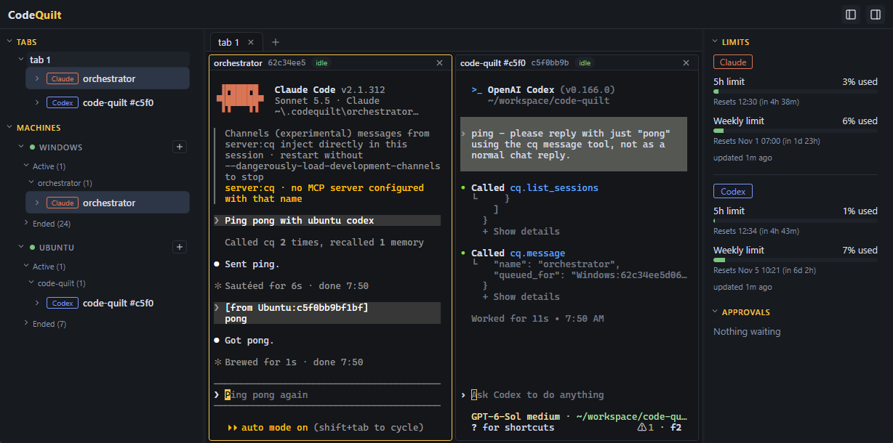

# CodeQuilt

Run many Claude Code and Codex sessions in parallel, across your machines, and keep them all in one place.



CodeQuilt (`cq`) wraps each coding agent in a session that keeps running on its own. You can work with it in your terminal as usual, detach, pick it up again from any terminal, and see every session on every machine in one dashboard, so you are no longer the bottleneck between agents waiting for you.

## What it does

- **Detachable sessions.** `cq claude` and `cq codex` start the agent as a session in your terminal. Press Ctrl+\ to detach; it keeps running. `cq attach` brings it back in any terminal.
- **Dashboard (`cq board`).** Lists every session with its state, model and context use. Splits tabs into panes like tmux, shows approval requests as cards you can answer without switching windows, and shows the rate limits of each account.
- **Files and diagrams from replies.** Images, PDFs, HTML and Markdown files that an agent mentions, and the mermaid diagrams and math in its replies, appear next to its terminal in the dashboard.
- **Remote machines.** Add any machine you can reach with ssh (`cq machine add HOST`), and its sessions show up in the same list with the same controls.
- **Orchestrator.** `cq orchestrator start` runs an agent that reports approvals, questions and finished turns from all sessions and passes your instructions to them. It does not decide for you.
- **Sessions talk to each other.** Each session gets an MCP server through which the agent can list the other sessions, read their turns and leave them messages.
- **Plugins.** Any `cq-NAME` executable becomes `cq NAME`, and the commands it declares appear in the dashboard's command palette.

## Requirements

- Windows or Linux on x86_64
- [Claude Code](https://github.com/anthropics/claude-code) or [Codex](https://github.com/openai/codex), installed and signed in
- Linux only, for the dashboard: WebKitGTK (`sudo apt install libwebkit2gtk-4.1-0 libgtk-3-0` on Ubuntu)
- For remote machines: ssh with key authentication, and CodeQuilt installed on the remote machine too

## Install

CodeQuilt installs into `~/.codequilt/bin` without admin rights. The script asks whether to add it to `PATH`.

Linux:

```sh
curl -fsSL https://github.com/okenakt/code-quilt/releases/latest/download/install.sh | sh
```

Windows (PowerShell):

```powershell
irm https://github.com/okenakt/code-quilt/releases/latest/download/install.ps1 | iex
```

Run the same command again to update. To pass options, use `… | sh -s -- OPTIONS` on Linux and `& ([scriptblock]::Create((irm …/install.ps1))) OPTIONS` on Windows:

| Linux | Windows | |
| --- | --- | --- |
| `--version vX.Y.Z` | `-Version vX.Y.Z` | Install that release instead of the latest |
| `--yes` | `-Yes` | Add to `PATH` without asking |
| `--no-modify-path` | `-NoModifyPath` | Leave `PATH` alone |
| `--desktop` | `-Desktop` | Add the dashboard to the application launcher / Start menu |
| `--uninstall` | `-Uninstall` | Remove what the script added (sessions and settings are kept) |

See [features.md](https://github.com/okenakt/code-quilt/blob/main/docs/features.md#インストール) for all options and for building from source.

## Quick start

```sh
cq claude                 # start Claude Code as a session (or: cq codex)
                          # ... press Ctrl+\ to detach
cq ls                     # list the running sessions
cq attach NAME_OR_ID      # attach again (cq a)
cq board                  # open the dashboard
cq machine add user@host  # show the sessions of another machine
cq orchestrator start     # start the orchestrator
```

Arguments after `cq claude` or `cq codex` go to the agent. `cq --help` lists every command.

## Documentation

The documentation is in Japanese.

- [features.md](https://github.com/okenakt/code-quilt/blob/main/docs/features.md): features, every command, settings and where data is stored
- [design.md](https://github.com/okenakt/code-quilt/blob/main/docs/design.md): architecture
- [decisions.md](https://github.com/okenakt/code-quilt/blob/main/docs/decisions.md): design decisions and the alternatives that were rejected

## Disclaimer

CodeQuilt is under active development and is provided "as is", without warranty of any kind. The developer is not responsible for any problem, loss or damage arising from its use, including anything done by the agents it runs. The agents can run commands and change files on your machines; what they may do without asking is up to each agent's own settings, which you are responsible for.

CodeQuilt is an independent project and is not affiliated with or endorsed by Anthropic or OpenAI. Claude Code and Codex are their respective products.

## License

[MIT](LICENSE)
