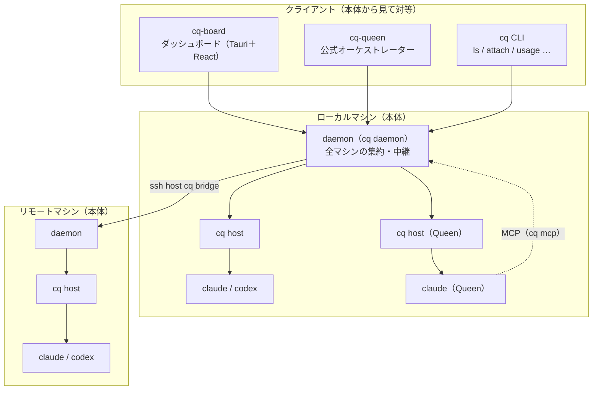
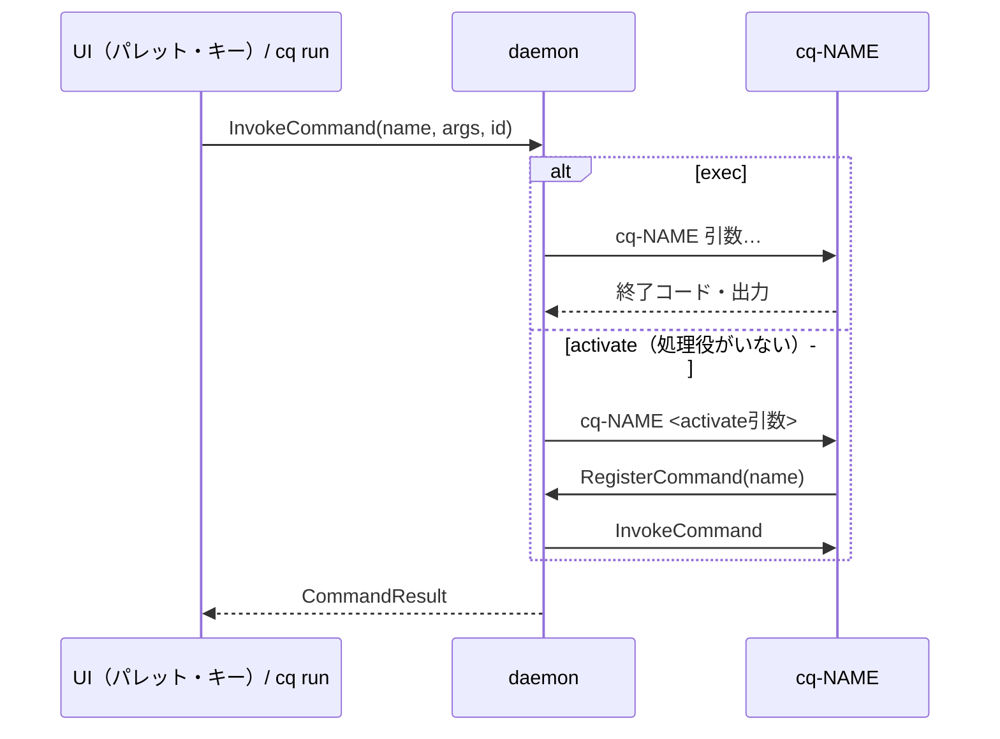
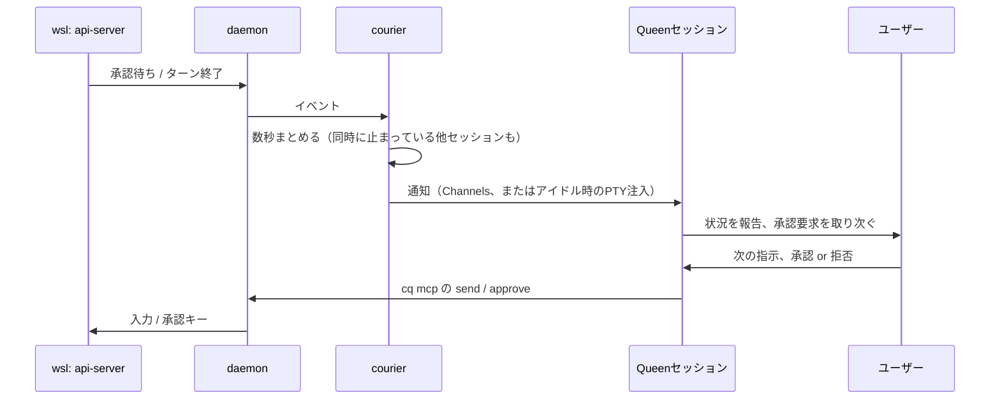

# CodeQuilt 設計

## 概要と目的

CodeQuilt（コマンド名 `cq`）は、並列に動かす複数のコーディングエージェント（Claude Code、Codex）のセッションを一元管理し、人間がボトルネックになる状態を解消するための基盤である。本体はエージェントのプロセスをラップして全マシンのセッションを束ねることに徹し、ダッシュボード（cq-board）やオーケストレーター（cq-queen）はその上に載るクライアントとして提供する。

設計の中心は次の3点である。

- **セッションの寿命をクライアントから切り離す**：ダッシュボードが未起動・クラッシュしてもセッションは無傷で、後から取り込める。
- **ローカルと同じ体験**：手元のターミナルでの操作は変わらず、ダッシュボードのペインからも同じように操作できる。
- **本体は薄く、仲介は外側に**：本体だけでもマルチプレクサとして使える。他のセッションの仲介は公式オーケストレーターcq-queenが担い、ユーザーが自分のオーケストレーターを作って置くこともできる。

機能・コマンド・設定の一覧は [features.md](features.md)、判断の経緯と不採用案は [decisions.md](decisions.md) にある。

### 名前の由来

コンセプトはセッションを繋ぎ合わせた蜂の巣である。多数のエージェント（働き蜂）を統べる存在として、オーケストレーターをQueenと呼ぶ。

CodeQuilt／`cq` は三重の意味を持つ。

- **Quilt**：個々のセッションをキルトのように繋ぎ合わせ、一枚の画面にまとめる。
- **Q**：蜂の巣をオーケストレーションするQueenのQ。
- **cq**：無線通信で全ての局に応答を呼びかけるサイン。全セッションに呼びかけ、応答を集める役割に重ねている。

## 要件

| 区分         | 要件                                                                                                   |
| ------------ | ------------------------------------------------------------------------------------------------------ |
| エージェント | Claude CodeとCodex                                                                                     |
| OS           | WindowsとLinux（Ubuntu、WSLで確認）                                                                    |
| 仲介         | Queenを置けば稼働中のセッションをQueenが仲介する。置かずにマルチプレクサとして使うこともできる         |
| 取り込み     | 手元で起動したセッションを後から取り込める。ダッシュボードが停止していてもセッションは影響を受けない   |
| リモート     | sshで届くリモートマシンのセッションも同じ画面で扱う                                                     |
| 実行環境     | bash、PowerShell、WezTermのどれで起動しても動く                                                        |
| UI           | スタンドアローンのダッシュボード。セッション一覧と、タブごとにペインを分割して並べるメインエリア                       |
| 入力         | キーボード。音声入力はOSの機能（WindowsのWin+H、Ubuntu 26.10以降の音声入力）やエージェントの `/voice` を使う |
| 可視化       | アカウントごとの5h / weeklyレート制限、セッションごとのモデル・コンテキスト・トークン、ディレクトリごとのトークン |
| 対象外       | 自動承認ポリシー（各エージェントのローカル設定の範囲）                                                 |

## 全体アーキテクチャ

実行ファイルは `cq`（本体）と、その隣に置くプラグイン `cq-board`、`cq-queen` の3つで、どれも `cq` のサブコマンドとして呼べる（`cq board`、`cq queen`）。本体の常駐プロセスは2種類あり、どちらも `cq` のサブコマンドとして動く。

- **cq host**（`cq host`、内部用）：セッションごとに1つ。エージェントをPTYの中で動かす。
- **daemon**（`cq daemon`）：マシンごとに1つ。そのマシンのセッションを束ね、クライアントに中継する。



| 層 | 構成要素 | 役割 |
| --- | --- | --- |
| 本体 | cq host | セッションごとにPTYを保持。hooks・statusLine・トランスクリプトの集計、承認プロンプトの検出とキー送信、終了処理 |
| 本体 | daemon | マシンごとの発見・中継・起動。ローカルのdaemonは登録済みのリモートのdaemonにもsshで接続し、全マシンを一つの口に集約する。状態は持たない |
| 本体 | cq CLI / `cq mcp` | 人間向けのCLIと、エージェント向けのMCPサーバー。どちらもdaemonのクライアント |
| 契約 | cq-proto / cq-client | プロトコルの型と、Rust製クライアント用のSDK（daemonへの接続・起動、セッションのモデル、範囲指定） |
| クライアント | cq-board（`board/`） | 一覧・タブとペイン・承認のカード・使用量・コマンドパレット。データは持たず本体の状態を表示する |
| クライアント | cq-queen | 公式オーケストレーター。Queen自体は名前を持つ普通のセッションで、配達役（courier）が他セッションの出来事をQueenに届ける |

- クライアントはローカルのdaemonにだけ接続し、無ければ起動する。リモートへのssh接続はdaemonが受け持つ。
- クライアント同士は依存しない。Queenも本体から見れば名前の付いたセッションの一つで、ダッシュボードはそれを上部に固定（ピン留め）できるだけ。
- エージェントの違い（起動方法、hooksの渡し方、使用量の読み方、画面の癖）は本体の中の小さな分岐に閉じ込める。

## セッション接続と通信

セッションは `cq claude` / `cq codex` で起動し、cq hostがエージェントのPTYを保持する。ダッシュボードやQueenから起動したセッションも、daemon経由で同じcq hostとして動く。

### cq host（セッションごとの常駐プロセス）

- dtach型。起動するとConPTY（LinuxではUnix PTY）を握ったまま切り離されて残る。手元の端末は `cq attach` で何度でも付け外しできる。
- エージェントの出力を接続中の全クライアントに配信し、入力はどのクライアントからでも受け付ける。
- 自分からは接続しに行かず、IPCの口を開けて待ち受ける（Windows: `\\.\pipe\codequilt-<id>`、Linux: `~/.codequilt/run/<id>.sock`）。
- `~/.codequilt/sessions/<id>.json` にpid・エージェント・cwd・パイプ名・名前・開始と終了の時刻・エージェント側のセッションIDを書く。アカウントと1時間ごとのトークン数も書き（トークンは1分に1回と終了時）、終了後も集計に使えるようにする。
- 内部で端末エミュレータ（vt100）を動かし、現在の画面グリッドを保持する。途中から接続したクライアントにもスナップショットで正しい画面を渡し、承認プロンプトの検出にも使う。
- イベントの履歴（直近200件と、statusLine・アカウント・トークンの最新値）を持ち、接続したクライアントに再送する。本体の他の部分は状態を持たない。
- 起動した側の内部状態を示す環境変数（入れ子のClaude Codeセッションの印、Voltaのツール実行中の印）はエージェントに渡さない。
- セッションごとに別プロセスなので、1つが落ちても他に影響しない。

### daemon（`cq daemon`）

- sessionsディレクトリを読んでセッションを発見し、pidの生存確認で終了したものを終了扱いにする。
- マシン内のcq hostを束ね、クライアントには単一の経路で公開する。状態を持たない中継役なので、止めて起動し直してもセッションは動き続け、常駐するクライアント（board、courier、`cq mcp`）はつなぎ直して（daemonが無ければ起動して）元の状態を受け取り直す。
- 起動を受けたら、cq hostがセッションを登録してから `Launched` を返す。返事を受けた時点でそのセッションはどの一覧にも載っている。
- ローカルのdaemonは登録済みのリモートマシンのdaemonにもsshで接続し、全マシンのセッションをまとめて公開する（集約）。
- デスクトップの状態（フォーカス、コマンド）はUIのあるマシンのものなので、リモートのdaemonからは中継しない。

### リモート接続

- ローカルのdaemonが `ssh -T -o BatchMode=yes <host> cq bridge` を実行し、その標準入出力をリモートのdaemonとの通信路にする。リモート側にポートを開けず、既存のSSH鍵認証を使う（鍵はパスフレーズなしかssh-agentで使える必要がある）。
- リモートの `cq bridge` は、リモートのdaemonが無ければ起動する。`login_shell` を指定したマシンは `sh -lc` 経由で起動し、`~/.profile` のPATH（Volta、`~/.local/bin` など）をエージェントに届ける。
- 中央サーバーは持たないので、マシンは `cq machine add` で事前に登録する。接続できないマシンは「オフライン」と表示し、再接続を試み続ける。

### プロトコルと安全性

- メッセージは `[u32 長さ][u8 種類][本体]` のフレーム。セッション単位では、ハンドシェイク、画面スナップショット、以降は出力・入力・リサイズ・入力権・イベント。daemon経由では、どのマシンのどのセッションかを付けて中継する。
- ハンドシェイクでプロトコルバージョンを交換し、不一致はエラーとして表示する。リモートの `cq` は手動で配置し、パスが違えば `cq_path` で指定する。
- 名前付きパイプとソケットは現在のユーザーだけが接続できるようにする。端末入力を流せる経路なので、緩めるとコマンド実行の口になる。

## 状態検出と情報源、設定の注入

### 情報源の役割分担

| 情報源                 | 得るもの                                                                                                                       |
| ---------------------- | ------------------------------------------------------------------------------------------------------------------------------ |
| hooks                  | SessionStart（エージェント側のセッションID）、UserPromptSubmit（作業開始）、Stop（ターン終了）、Notification / PermissionRequest（承認待ち） |
| statusLine             | レート制限（5h / weekly）、モデル、コンテキスト使用率。Codexはrolloutの `token_count` から同じ形に揃える                        |
| トランスクリプト       | 応答の中身、メッセージごとのモデルとトークン                                                                                   |
| cq hostの画面グリッド  | 承認プロンプト・確認ダイアログが実際に表示されているか、入力欄が空か                                                           |
| 認証情報               | アカウント（Claudeは `.claude.json`、無ければ `claude auth status`。Codexは `auth.json` のid tokenのクレーム）                   |

### 設定の注入

- Claude Codeは `claude --settings ~/.codequilt/claude.json` で起動し、hooksとstatusLineだけを注入する。`~/.claude` 配下には書き込まない。
- Codexは `-c hooks.<Event>=[...]` で同じhooksを渡す。
- **hooksは何も出力しない**：標準出力はコンテキストに注入されるため。イベントをcq hostに送って正常終了するだけにし、トークン消費を増やさない。cq hostが不在でもすぐ終わる。
- **statusLineはユーザー設定に連鎖させる**：`cq statusline` はデータをcq hostに送ったうえで、ユーザーの `settings.json` にある元のコマンドを呼び、その出力を表示する。ローカルの見た目は変わらない。

## 入力と承認

### 入力

- ペインはxterm.jsで描画し、キー入力はそのままバイト列としてPTYに流す。作業中に入力したときの挙動もエージェント自身の挙動になる。
- cq hostは解釈せずバイト列を素通しする。Shift+Enter（`ESC[13;2u`）、ブラケットペースト、マウス、OSCシーケンスを壊さない。ConPTYが求めるカーソル位置の問い合わせにはcq hostが答える。
- **入力権**：最後に入力した端末やペインが入力権を持ち、PTYの大きさはそのクライアントに合わせる。QueenやCLIの送信（monitor）は入力権を奪わない。
- **アイドル時の注入**：エージェントがアイドルで、入力欄が空で、一定時間誰も入力していないときだけ文字を入れる。

### 承認

PermissionRequest hookでダッシュボードの回答を待つと、その間ローカルのTUIに承認プロンプトが出ず、手元で答えられなくなる。そのため次の方式を取る。

1. hooksは「承認待ちになった」通知だけに使い、すぐに返す。ローカルのプロンプトは通常通り表示される。
2. cq hostが画面グリッドからプロンプト（承認の要求と、フォルダの信頼などの確認ダイアログ）を検出し、本文から作ったIDを付けてイベントとして流す。
3. ダッシュボードはセッション名・マシン・cwd・内容・選択肢を明示したカードを出す（「ダッシュボードの画面」の「承認」）。
4. カードで答えると、cq hostがIDを照合して同じプロンプトがまだ表示されていることを確かめてから、キーを送る。番号付きの選択肢は番号を、番号の無い選択肢（`❯` で選択中を示すもの）は矢印キーで選択を動かしてEnterを送る。
5. ローカルとカードのうち先に答えた方が採用される。ローカルで答えたらカードは自動で消える。

## クライアントの拡張

本体を薄く保ち、根幹以外はクライアントとして足す。公式のクライアントもこのリポジトリに置くが、本体からはサードパーティと同じ扱いにする。

- クライアントはdaemonにプロトコル（cq-proto）で接続する。Rustなら `cq-client` を使う。
- 本体はクライアントの名前を持たない。クライアント同士も直接やり取りしない。協調が必要な情報（セッション名、フォーカス、コマンド）は本体の状態として持つ。
- **外部サブコマンド**：`cq NAME 引数…` は組み込みのサブコマンドでなければ `cq-NAME 引数…` を実行する（gitやcargoと同じ）。探す順はcq本体と同じディレクトリ、次に `PATH`。サブコマンドの別名（エイリアス）は `config.toml` で定義できる。

### 本体がクライアントに提供するもの

| 種類 | 内容 |
| --- | --- |
| セッション | 一覧、状態、名前（動いているセッションの中でマシンごとに一意）、新規起動・resume・終了 |
| イベント | hooks、プロンプトの出現と解消、statusLine、トークン集計、アカウント |
| 操作 | 入力、承認（プロンプトIDを照合）、アイドル時の注入、名前の変更、終了（エージェントに終了させ、猶予後に強制終了） |
| フォーカス | UIが「いま入力先にしているセッション」を本体に知らせる |
| コマンド | プラグインがmanifestで宣言したコマンドを、パレットやキーやCLIから呼ぶ |
| MCP | `cq mcp`：セッション一覧、ターン内容、送信、承認、起動をツールとして公開。Claude CodeとCodexの両方から使える |

### コマンドとプラグイン

VS Codeの拡張と同じ考え方で、プラグインは提供するコマンドをmanifestで宣言する。導入済みのプラグインのコマンドは、プラグインが動いていなくてもコマンドパレットに出て、キーにも割り当てられる。UIの組み込み操作も同じ「コマンド」として扱う。

- **導入**：cq本体と同じディレクトリにある `cq-*` は、一緒に導入された公式プラグインとして自動で導入済みになる（daemonが起動時に `cq-NAME manifest` を読む）。それ以外は `cq plugin add NAME` で導入する。明示的に導入したものと本体の隣にあるもの以外は実行しない。
- **manifest**：`cq-NAME manifest` が出すJSON。コマンドごとに名前・表示名・引数・既定のキー・実行方式を持つ。

```json
{
  "name": "queen",
  "commands": [
    {
      "name": "queen.start",
      "title": "Queen: Start",
      "args": [
        { "name": "name", "title": "Queen name", "default": "queen" },
        { "name": "agent", "title": "Agent (claude / codex; empty: as in the settings)", "default": "" }
      ],
      "run": { "exec": ["start", "${name}", "agent=${agent}", "--detach"] }
    }
  ]
}
```

- **実行方式**（コマンドごとにプラグインが選ぶ）
  - `exec`：呼ばれるたびに `cq-NAME 引数…` を起動し、終わるのを待って結果（標準出力、失敗なら標準エラー）を返す。最大120秒。
  - `activate`：常駐するプロセスに処理させる。処理役（`RegisterCommand`）がいればそこへ中継し、いなければ起動して登録を待つ（最大10秒）。
- 引数の `${名前}` は、呼び出しの引数、宣言の既定値、呼び出し時のフォーカス（`${machine}`、`${session}`）から埋める。
- 実行時に登録されるだけのコマンド（例 `channel:<session>`）はプログラム同士の呼び出し専用で、パレットには出ない。



### 設定ファイル

人が編集する設定はすべてTOMLにする（コメントが書け、`toml_edit` でコメントや並びを保ったままプログラムから書き換えられる）。キーの一覧は [features.md](features.md) にある。

| ファイル | 内容 | 読む側 |
| --- | --- | --- |
| `~/.codequilt/config.toml` | 起動を許すディレクトリ、エイリアス、リモートマシン | cq / daemon |
| `~/.codequilt/ui.toml` | ダッシュボードの設定 | cq-board |
| `~/.codequilt/keybindings.toml` | キーバインド | cq-board |
| `~/.codequilt/queens/NAME.toml` | Queenごとの設定 | cq-queen |

- プログラムが生成する状態（`sessions/*.json`、`plugins/*.json`）や、Claude Code・MCPがJSONを求めるファイル（`claude.json`、`*.mcp.json`）はJSONのまま。
- 効いている設定はファイルに見えるようにする。`ui.toml` は無ければ既定の内容を書き出す。キーバインドの既定は組み込みで、`keybindings.toml` は上書きだけを書く。
- ダッシュボードは `ui.toml` と `keybindings.toml` を監視して、変更をすぐに反映する。

## cq-queen（公式オーケストレーター）

Queenは「他のセッションを仲介してくれるセッション」である。本体から見ればQueenの名前（例 `queen`）を持つ普通のセッションで、cq-queenの配達役（courier）が他セッションの出来事をQueenに届ける。Queenを置くかどうか、何体置くかはユーザーが選ぶ。



1. 範囲内のセッションがターンを終えるか、承認・質問待ちになると、courierがイベントを受け取る。
2. 数秒（`batch_seconds`）まとめてからQueenに届ける。通知には各セッションの名前・マシン・状態・最後の返答・承認プロンプトの内容と選択肢、まだ待っているものの一覧を入れる。
3. Queenは状況を報告し、承認要求はユーザーに取り次ぐ。**Queenは代わりに判断しない**。ダッシュボードの承認ダイアログも並行して出し、先に答えた方が採用される。
4. ユーザーの指示を、Queenが `cq mcp` の `send` / `approve` で各セッションへ送る。`approve` は既定では事前許可せず、使うたびにQueen自身の確認を挟む。新しいセッションが要るときは `launch` で起動し、最初の指示はセッションがアイドルになってから注入する（`cq inject` と同じ待ち行列）。`launch` は事前許可する（起動できるディレクトリは本体が `allowed_roots` と信頼済みのフォルダに限るため）。

- Queen自身のイベントは届けない（無限ループの防止）。ユーザーがセッションに直接入力したら、そのセッションの未処理の項目は取り下げる。
- **届け方**：Claudeの既定はChannels（入力欄と干渉せず、通知が「ユーザーの発言」として履歴に混ざらない）。起動のたびに開発用チャネルの確認が出るので、ダッシュボードの承認ダイアログで答える。Channelsが使えないときと、Codex（Channelsに当たる仕組みがない）はPTY注入（アイドルで入力欄が空のときだけ）を使う。
- **エージェントごとの渡し方**：同じ中身（`cq mcp`、確認なしで使えるツール、人格、モデル）を、Claudeには `--mcp-config`（`NAME.mcp.json`）・`--allowedTools`・`--append-system-prompt`・`--model` で、Codexには `-c` の上書き（`mcp_servers.cq.*`、ツールごとの `approval_mode = "approve"`、`developer_instructions`）と `-m` で渡す。値は英数字といくつかの記号以外を `\u` でエスケープしたTOMLの文字列にする（Windowsでは `codex.cmd` 経由で起動するため、`cmd.exe` が `<` や `"` や改行を解釈しないように）。
- **設定と上書き**：設定は `NAME.toml`、起動時の `KEY=VALUE` でこの起動だけ上書きする（エージェントの切り替えなど）。`model` と `delivery` は書かなければエージェントごとの既定になるので、`agent` を上書きするだけで別のエージェントで動く。上書きはcourierにも渡す。
- **cqの場所**：MCPの設定にはcq本体の絶対パス（cq-queenの隣、または `CQ_BIN`）を書く。見つからなければ起動を失敗させる。名前だけを書くと `PATH` 上の古いcqが使われうるため。
- **特定**：Queenは名前で特定する（名前は一意）。`queen.start` は同名のセッションが動いていれば何もせず成功を返す。
- 設定はQueenごとに `~/.codequilt/queens/NAME.toml` を置き、複数のQueenを同時に動かせる。

## ダッシュボードの画面

セッションは長く動き続ける端末なので、エディタのように「分割の中にタブ」を置くのではなく、tmuxやi3のように「タブの中にペインを並べる」。タブはワークスペース（プロジェクトやマシン）の単位で、各タブが自由なペイン配置を持つ。

```
 CodeQuilt                                          [承認待ち] [◧] [◨]
┌ 左サイドバー ─────┬ メインエリア ───────────────────────────┬ 右サイドバー ─┐
│ ▾ Pinned          │ [code-quilt] [wsl] [調査] [+]            │ ▾ Approvals   │
│ ▾ Tabs            │ ┌ api ab12cd34 working ───────┐┌ web … ┐ │ ▾ Limits      │
│ ▾ Machines        │ │                              ││        │ │ ▾ Tokens      │
│                   │ └──────────────────────────────┘└────────┘ │               │
└───────────────────┴──────────────────────────────────────────────┴───────────────┘
                                                        右下：承認待ちのカード
```

### レイアウト

- **上部**：1段で、左にタイトル、右端に承認待ちの件数と左右のサイドバーを開閉するボタン（`ui.toggleLeftSidebar` / `ui.toggleRightSidebar`）。
- **左サイドバー**：Pinned（ピン留め）、Tabs（タブ→セッション）、Machines（マシン→Active / Ended→セッション）の3つの欄。欄やその中の項目は折りたためる（欄ごとに隠す機能は折りたたみで足りるので持たない）。
  - セッションの行はどの欄でも同じ部品で、名前・id・状態、ピン、終了（ゴミ箱）、詳細の展開を持つ。ピンと終了のボタンはホバーしたときだけ出し、ピン留めしたセッションは横向きのピンを常に出して見分けられるようにする。詳細の展開は欄ごとに独立で、同じセッションが複数の欄にあっても別々に開く。
  - セッションの行は列（名前・id・状態）に分け、名前とidは固定幅にして、状態が変わってもidなどの位置が動かないようにする。列の幅はどの行でも右端をドラッグして変えられ、すべての欄（終了したセッションの行も）で共有する。
  - 字下げは1階層ごとに同じ幅（`--indent`）。セッションの行は、いちばん深いMachines（マシン→Active→セッション）に合わせて、PinnedとTabsでも同じ位置から始め、サイドバーの幅に対して1行に出る情報量を揃える。
- **メインエリア**：上にタブの帯、その下に選択中のタブのペイン。
- **右サイドバー**：Approvals（承認待ちの一覧）、Limits（レート制限）、Tokens（ディレクトリごとのトークン）。欄は折りたためる。
- 左右のサイドバーは開閉でき、幅は境界をドラッグして変えられる。幅、表示・非表示、折りたたみ、タブとペインの配置はダッシュボード側に保存する。

### タブとペイン

- **タブ**：名前を付けられる（既定は `tab N`。すべて閉じたときにできるタブも同じ）。追加、名前の変更、並べ替え（ドラッグ）、閉じる。閉じたタブのセッションはデタッチされるだけで、動き続ける。空のペイン1つだけのタブでそのペインを閉じると、タブも閉じる。
- **ペイン**：タブごとに、左右・上下の分割を入れ子にした木構造で配置する。各ペインはセッションを1つ表示するか、空。境界をドラッグして大きさを変えられる。
- **分割**：上下左右の4方向のコマンドがあり、どれも「その方向に空のペインを作ってフォーカスする」。空のペインには「セッションを開く」「新しいセッション」のボタンを出す。分割した結果がすぐ目に見えるよう、空のペインも区切って表示する。
- **一覧から開く**：今のタブにあればそのペインにフォーカスするだけ。無ければ、フォーカス中のペインが空ならそこに入れ、空でなければそのペインを分割して入れる。分割の向きは親の分割と逆（未分割なら左右に並べる、その次は上下、…）。
- **複数のタブ**：同じセッションを別々のタブに置ける（同じタブには1つだけ）。描くのは表示中のタブのペインだけで、タブを切り替えると端末を作り直して画面を取り直す（PTYの大きさは表示中のペインに合う）。そのため、端末のスクロールバック（画面より上の履歴）はタブを切り替えると残らない。
- **ペインの見出し**：1行で、名前・id・状態（working / idle / needs approval）と、ペインを閉じる✕（セッションは動き続ける）。セッションの終了は左サイドバーの行のゴミ箱で行う。
- **アイコン**：すべてlucide（`lucide-react`）で描く。表示を閉じるだけ（ペイン・タブなど）は✕、セッションの終了はゴミ箱にする。フォーカス中のペインは枠の色で示す。
- **ドラッグ**：見出しを掴んで動かす。規則は「分割して移る」の1つだけにしている。
  - ペインは対角線で4つに分かれ、落とした位置に近い辺の方向にそのペインを分割して移る。空のペインも同じで、埋めずに分割する。ドラッグ中は移る先の領域を重ねて表示する。
  - タブの帯のタブに落とすと、そのタブへ移ってそのタブを表示する（入る場所は一覧から開くときと同じ規則）。タブの上で0.5秒待つとそのタブが表示され、そのタブのペインに落として置き場所を選べる。
  - 移す先のタブに同じセッションがあるとき（落としたときも、待ったときも）と、置き場所のない所で離したときは、移さずに元のタブの表示に戻し、トーストで知らせる。自分のペインの上で離すのは元の位置への移動で、何も起きない。
  - ペインを移して元のタブにペインが残らなければ、そのタブを閉じる。
  - タブのドラッグ中は、タブの帯を落とした後の並びにその場で並べ替えて表示する。
- 終了したセッションや存在しないセッションのペインは自動で閉じる。

### 承認

- 承認待ちが来たら、右下に内容と選択肢のカードを積み重ねて出す。入力のフォーカスは奪わない（ペインで打っている文字が回答にならないようにするため）。
- カードは最小化できる。最小化しても右サイドバーのApprovalsに残り、項目を選ぶとカードがもう一度出る。
- `ui.approvals`（既定 Ctrl+Shift+A）で最新のカードにフォーカスし、キーボードで答えられる。
- 承認待ちのセッションのペインは枠の色で知らせる。

### キーバインドの画面

- `ui.keybindings` でメインエリアにキーバインドの画面を重ねて開く。すべてのコマンド、今のキー、出どころ（組み込み・プラグイン・ユーザー）を一覧し、行を選んでキーを押すと割り当てを変えられる。変更は `keybindings.toml` にコメントを保ったまま書き込む。

組み込みコマンドと既定のキーの一覧は [features.md](features.md) にある。既定のキーはCtrl+Shift系とAlt+数字だけを使い、エージェントが使うキーと重ならないようにする。

## セッション管理

- **一覧**：マシンごとに、動いているセッションと終了したセッションを分けて表示する。終了したセッションのメタデータ（エージェント側のセッションIDを含む）は残る。
- **resume**：終了したセッションを、同じcwdでエージェントのresume（`claude --resume <id>` など）として起動し直す。
- **新規起動**：任意のマシンで、そのマシンのClaude CodeやCodexで信頼済みのフォルダ（`.claude.json` の `hasTrustDialogAccepted`、Codexの `trust_level = "trusted"`）か、許可されたディレクトリ（`allowed_roots`、既定はホーム）の配下で起動できる。どちらも開くたびに読み直すので、設定や信頼の変更はすぐに反映される。
- **名前**：動いているセッションの名前はマシンごとに一意で、重複する名前での起動や改名は断る。名前・id・idの前方一致のどれでもセッションを指定できる。
- **終了**：`cq kill` かダッシュボードの「End session」で、エージェント自身に終了させる（Esc → Ctrl+C → 終了コマンドの順）。猶予（既定10秒）内に終わらなければ強制終了する。強制終了するとClaude CodeのRemote Controlのセッションが片付かないので、通常はこの手順で終える。ペインやタブを閉じる操作はデタッチで、セッションは終わらない。
- **レイアウト**：タブとペインの配置、サイドバーの幅・表示・折りたたみ、ピン留めの選択はダッシュボード側に保存する。

## 使用量の可視化

- レート制限はマシンではなくアカウントで集約し、エージェント（Claude / Codex）ごと、アカウントごとに5hとweeklyの使用率とリセット時刻を表示する。別アカウントを2台で使えば2つ、同じアカウントなら1つにまとまる。
- statusLineは描画時にしか更新されないので、「最終更新◯分前」を併記する。取れないときは「不明」と表示する。
- セッションごとに、モデル、コンテキストの使用率、トークンの累計（トランスクリプトから集計）を表示する。
- **ディレクトリごとのトークン**：マシンとcwdとエージェント（Claude / Codex）ごとに、期間（24h / 7d / all）内のトークン（入力・出力・キャッシュの読み書きの合計）を、表示中の最大を基準にしたバーで表示する。各項目はエージェントとアカウント、その下にバーと使用量。木（マシン→ディレクトリ→エージェント）と、使用量の多い順の一覧（エージェントごとに別の項目）を切り替えられる。使っていないエージェントは出さない。
  - 集計の元はcq hostがメタデータに書く1時間ごとのトークン数で、終了したセッションも含む。時刻はトランスクリプト（Claude）やrollout（Codex）の各行の `timestamp` を使い、Codexは累計の増分をその時刻に割り当てる。
  - resumeしたセッションはエージェントのログを最初から読み直すので、同じエージェント側のセッションIDを持つセッションは1時間ごとに大きい方を採って重複を除く。
  - CodeQuiltの外で動かしたセッションは数えない。

## 技術スタック

| 対象                  | 採用                              | 理由                                                                     |
| --------------------- | --------------------------------- | ------------------------------------------------------------------------ |
| 本体（cq）とプラグイン | Rust                              | 単一バイナリでリモートに置きやすい。セッションごとのプロセスが数MBで済む |
| PTY                   | portable-pty                      | ConPTYとUnix PTYの差を吸収                                               |
| IPC                   | tokio（named pipe / unix socket） | 現在ユーザーのみのアクセスを直接指定できる                               |
| 端末エミュレータ      | vt100                             | cq host内で画面グリッドを保持                                            |
| ダッシュボード        | Tauri＋React、xterm.js            | タブとペインの分割は自前の小さな部品で実装する                           |
| エージェント連携      | MCP（`cq mcp`）                   | Claude CodeとCodexの両方から本体の操作を呼べる                           |
| 設定                  | toml / toml_edit                  | コメントを保ったまま読み書きできる                                       |

## 未実装・未決事項

- [ ] リモートマシン上のQueen、リモートマシンのプラグインのコマンド
- [ ] リモートへの `cq` バイナリの配布（当面は手動で置き、`cq_path` で指定）
