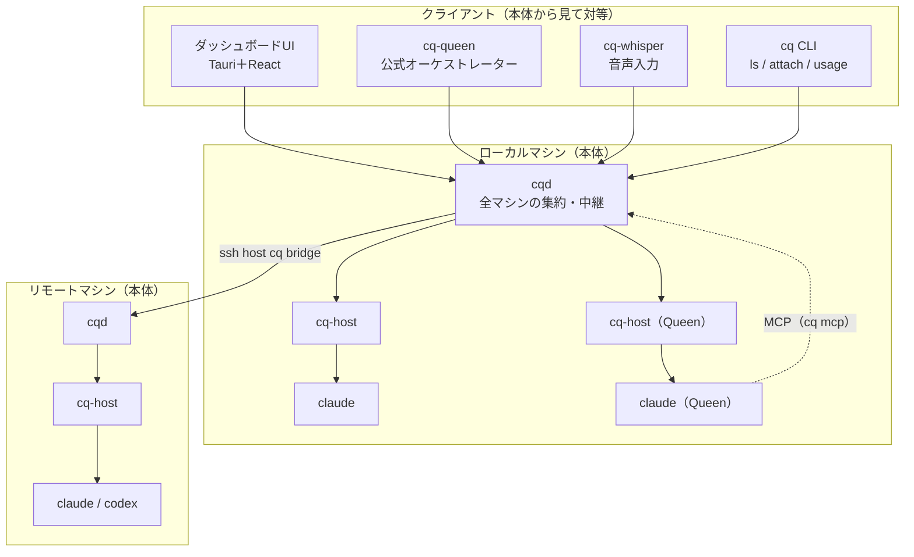
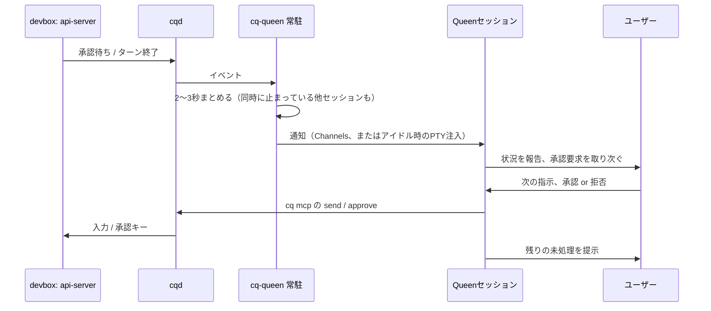

# CodeQuilt 設計方針

2026-10-01 · okenakt

## 概要と目的

CodeQuilt（コマンド名 `cq`）は、並列に動かす複数のClaude Codeセッションを一元管理し、人間がボトルネックになる状態を解消するための基盤である。本体はエージェントのプロセスをラップして全マシンのセッションを束ねることに徹し、ダッシュボードやオーケストレーター（Queen）はその上に載るクライアントとして提供する。将来はCodexにも同じ仕組みで対応する。

設計の中心は次の3点である。

- **セッションの寿命をハブから切り離す**：ハブが未起動・クラッシュしてもセッションは無傷で、後から取り込める。
- **ローカルと同じ体験**：手元のターミナルでの操作は変わらず、CodeQuiltのタイルからも同じように操作できる。
- **本体は薄く、仲介は外側に**：本体だけでもマルチプレクサとして使える。他のセッションの仲介は公式オーケストレーターcq-queenが担い、ユーザーが自分のオーケストレーターを作って置くこともできる。

### 名前の由来

コンセプトはセッションを繋ぎ合わせた蜂の巣である。多数のエージェント（働き蜂）を統べる存在として、オーケストレーターをQueenと呼ぶ。

CodeQuilt／`cq` は三重の意味を持つ。

- **Quilt**：個々のセッションをキルトのように繋ぎ合わせ、一枚の画面にまとめる。
- **Q**：蜂の巣をオーケストレーションするQueenのQ。
- **cq**：無線通信で全ての局に応答を呼びかけるサイン。全セッションに呼びかけ、応答を集める役割に重ねている。

## 要件

| 区分         | 要件                                                                                                                                     |
| ------------ | ---------------------------------------------------------------------------------------------------------------------------------------- |
| エージェント | 当面はClaude Code。後でCodexに対応しても崩れない構造にする                                                                               |
| OS           | 当面はWindows。後でUbuntuに対応しても困らない技術を選ぶ                                                                                  |
| 仲介         | オーケストレーター（Queen）を置けば、稼働中のセッションをQueenが仲介する。置かずにマルチプレクサとして使うこともできる                    |
| 取り込み     | 手元で起動したセッションを後から取り込める。ハブが未起動・停止していてもセッションは影響を受けない                                       |
| リモート     | リモートマシン上のセッションにも対応する                                                                                                 |
| 実行環境     | bash、PowerShell、WezTermのどれで起動しても動く                                                                                          |
| UI           | スタンドアローンのダッシュボード。タスク一覧と、タブ＋ペイン分割のタイル表示。配置はマウスドラッグとキーボードショートカットで変更できる |
| 入力         | キーボード。音声入力（Whisper、GPUかCPUを選択）はクライアントcq-whisperとして足す                                                         |
| ルーティング | Queenが入力の内容を把握して適切なセッションに流す。`@名前` で明示もできる。宛先が不明確なら確認する                                      |
| 可視化       | アカウントごとの5h / weeklyレート制限、セッションごとのモデルと消費トークン                                                              |
| 通知         | OS通知。Telegramブリッジは当面不要                                                                                                       |
| 対象外       | 自動承認ポリシー（各エージェントのローカル設定の範囲）                                                                                   |

## 全体アーキテクチャ

CodeQuiltの本体は「エージェントのプロセスをラップし、全マシンのセッションを一つの口に束ねる」ことに絞る。ダッシュボード、オーケストレーター（Queen）、音声入力などは、すべて本体に接続するクライアントとして外側に足す。本体を使うだけなら、CodeQuiltは単なるエージェントのマルチプレクサとして動く。



| 層 | 構成要素 | 役割 |
| --- | --- | --- |
| 本体 | cq-host | セッションごとにPTYを保持。hooks・statusLine・トランスクリプトの集計、承認プロンプトの検出とキー送信 |
| 本体 | cqd | マシンごとの発見・中継・起動。ローカルのcqdは登録済みのリモートcqdにもsshで接続し、全マシンを一つの口に集約する。状態は持たない |
| 本体 | cq CLI / `cq mcp` | 人間向けのCLIと、エージェント向けのMCPサーバー。どちらもcqdのクライアント |
| 契約 | cq-proto / cq-client | プロトコルの型と、Rust製クライアント用のSDK |
| クライアント | ダッシュボードUI | 一覧・タイル・承認ダイアログ・OS通知・使用量表示。データは持たず本体の状態を表示する |
| クライアント | cq-queen | 公式オーケストレーター。Queen自体は普通のセッションで、常駐プロセスが他セッションの出来事をQueenに届ける |
| クライアント | cq-whisper | 音声入力。文字起こしをフォーカス中のセッションに入れる |

- クライアントはローカルのcqdにだけ接続する。リモートへのssh接続はcqdが受け持つ。
- クライアント同士は依存しない。Queenも本体から見ればタグの付いたセッションの一つで、UIはそれを前面に固定（ピン留め）できるだけ。
- 将来のCodex対応では、claudeの位置にcodexが入り、状態と履歴の取得だけをAdapterで切り替える。

## セッション接続と通信

セッションはcqラップ方式で掴む。シェルのエイリアスで `claude` を `cq claude` に差し替え、cq-hostがclaudeのPTYを保持する。Channels方式は、Claude専用でCodexと仕組みが分かれるため採用しない。

### cq-host（セッションごとの常駐プロセス）

- dtach型。`cq claude` で起動するとConPTY（UbuntuではUnix PTY）を握ったまま切り離されて残る。
- claudeの出力を「手元のターミナル」と「接続中の全クライアント」に複製して配信し、入力はどちらからでも受け付ける。
- 自分からは接続しに行かず、IPCの口を開けて待ち受ける（Windows: `\\.\pipe\codequilt-<id>`、Ubuntu: `~/.codequilt/run/<id>.sock`）。
- `~/.codequilt/sessions/<id>.json` にpid・エージェント種別・cwd・パイプ名・開始時刻を書き出す。
- 内部で端末エミュレータ（`vt100` や `alacritty_terminal`）を動かし、現在の画面グリッドを保持する。途中からアタッチしたクライアントにも正しい画面を渡せる。
- セッションごとに別プロセスなので、1つが落ちても他に影響しない。

### cqd（マシンごとの中継デーモン）

- sessionsディレクトリを監視してセッションを発見し、pidの生存確認で死んだエントリを掃除する。
- マシン内のcq-hostを束ね、クライアントには単一の経路で公開する。状態を持たない中継役なので、落ちても再起動するだけで済む。
- ローカルのcqdは、登録済みのリモートマシンのcqdにもsshで接続し、全マシンのセッションをまとめて公開する（集約）。イベントの履歴は各cq-hostが持ち、再接続時に再送されるので、集約しても状態は持たない。

### クライアントとの接続

- **クライアント**：同じマシンのcqdに固定名で自動接続する。リモートのセッションもローカルのcqd経由で見える。
- **リモート（stdio方式）**：ローカルのcqdが `ssh <host> cq bridge` を実行し、その標準入出力をリモートのcqdとの通信路にする。リモート側にポートを開けず、既存のSSH鍵認証をそのまま使う（`BatchMode=yes` のため、鍵はパスフレーズなしかssh-agentで使える必要がある）。
- **マシンの登録**：中央サーバーは持たないため、監視するマシンは事前に登録する。`cq machine add` で `~/.ssh/config` のホストを候補として出し、選ぶだけにする。接続できないマシンは「オフライン」と表示し、定期的に再接続を試みる。
- 将来マシンが増えたら自前の軽量レジストリを後付けできるよう、接続先リストの部分は差し替え可能にしておく。

### プロトコルと安全性

- アタッチ時はハンドシェイク、画面スナップショット、以降はライブのバイト列。メッセージは出力・入力・リサイズ・入力権・状態イベント。
- ハンドシェイクでプロトコルバージョンを交換し、リモートの `cq` との不一致を検出する。更新の促しかバイナリの自動配布を最初から入れる。
- 名前付きパイプは現在のユーザーのみがアクセスできるACLにする。端末入力を流せる経路なので、緩めるとリモートからのコマンド実行口になる。

## 状態検出と情報源、設定の注入

状態モデルは当面Claude Codeベースで定義する。Codex追加時に、Claudeに合わせるか独自の状態を作るかを再検討する。

### 情報源の役割分担

| 情報源                | 得るもの                                                                                                                                                             |
| --------------------- | -------------------------------------------------------------------------------------------------------------------------------------------------------------------- |
| hooks                 | いつ何が起きたかの即時通知。SessionStart（セッションID）、UserPromptSubmit（経路を問わない直接入力の認知）、Stop（ターン終了＝カード生成）、Notification（承認待ち） |
| statusLine            | レート制限（5h / weekly）、モデル、コンテキスト使用率、コスト                                                                                                        |
| トランスクリプトjsonl | 応答の中身、メッセージごとのモデルとトークン内訳                                                                                                                     |
| cq-hostの画面グリッド | 承認プロンプトが実際に表示されているかの確認                                                                                                                         |

### 設定の注入

cq-hostは `claude --settings ~/.codequilt/claude.json` で起動し、hooksとstatusLineだけを起動時に注入する。`~/.claude` 配下には書き込まない。Codexでは `-c` の設定上書きで同様に渡す。

- **hooksは何も出力しない**：SessionStartとUserPromptSubmitの標準出力はコンテキストに注入されるため。イベントをcq-hostに送って正常終了するだけにし、トークン消費を増やさない。
- **hooksは送るだけで待たない**：ハブやcq-hostが不在でも即終了する。各セッションのスプールに追記し、ハブは起動時にそれを読んで状態を復元する。
- **statusLineはユーザー設定に連鎖させる**：`cq statusline` はデータをcq-hostに送ったうえで、ユーザーの `settings.json` にある元のコマンドを呼び、その出力を表示する。ローカルの見た目は変わらない。
- hooksの実行によるコストはプロセス起動の遅延のみ（Windowsで数十〜100ms程度）。

## 入力と承認

入力はローカルと同じ体験に揃える。承認は、どのセッションの要求かを明示したダイアログとして独立した機能にする。

### 入力

- タイルはxterm.jsで描画し、キー入力はそのままバイト列としてPTYに流す。作業中に入力したときの挙動もclaude自身の挙動になる。
- Queen経由の音声やテキストはブラケットペーストで送る。Enterを自動で押すかは設定で切り替える。
- cq-hostは「解釈せずバイト列を素通しする」。Shift+Enter（kittyキーボードプロトコル）、ブラケットペースト、マウス、OSCシーケンスを壊さない。
- **入力権**：手元とハブの同時入力が混ざらないよう、最後に操作した側に入力権を与える。
- **画面サイズ**：PTYのサイズは1つなので、アクティブなクライアントに追従させる。

### 承認ダイアログ

PermissionRequest hookでハブの回答を待つと、その間ローカルのTUIに承認プロンプトが出ず、手元で答えられなくなる。そのため次の方式を取る。

1. Notification hookは「承認待ちになった」通知だけに使い、すぐに返す。ローカルのプロンプトは通常通り表示される。
2. ハブはセッション名・マシン・cwd・ツール・コマンドを明示したダイアログを出す。
3. ダイアログで答えると、cq-hostが画面グリッドで承認プロンプトの表示を確認してから、PTYにキー入力を送る。
4. ローカルとダイアログのうち先に答えた方が採用される。ローカルで答えたらダイアログは自動で閉じる。

## クライアントの拡張

本体を薄く保ち、根幹以外はクライアントとして足す。公式のクライアントもこのリポジトリの `crates/` にRustで置くが、本体からはサードパーティと同じ扱いにする。

- クライアントはcqdにプロトコル（cq-proto）で接続する。Rustなら `cq-client` を使う。
- 本体はクライアントの存在を知らない。クライアント同士も直接やり取りしない。協調が必要な情報（セッション名、タグ、フォーカス）は本体の状態として持つ。
- 当面はユーザーが各クライアントを起動する（`cq queen start` など）。自動起動や管理の仕組みは必要になってから足す。

### 本体がクライアントに提供するもの

| 種類 | 内容 |
| --- | --- |
| セッション | 一覧、状態、名前（`cq rename`、未設定なら表示名から自動）、タグ（例 `queen`、`frontend`）、新規起動・resume |
| イベント | hooks（SessionStart / UserPromptSubmit / Stop / Notification）、承認プロンプトの出現と解消、statusLine、トークン集計、アカウント |
| 操作 | 入力（ブラケットペースト）、承認（プロンプトIDを照合して回答）、アイドル時の注入（対象がアイドルで、ユーザー入力が一定時間ないときだけ入れる） |
| フォーカス | UIが「いま入力先にしているセッション」を本体に知らせる。cq-whisperはそこへ送る |
| コマンド | クライアントが名前付きのコマンド（例 `whisper.pushToTalk`、押下と解放を区別できる）を本体に登録し、UIが一覧からボタンやキーに割り当てて呼ぶ。本体は呼び出しを登録元に中継するだけで、UIは登録元を知らない |
| MCP | `cq mcp`：セッション一覧、ターン内容の取得、送信、承認をツールとして公開。Claude CodeとCodexの両方から使える |

承認の回答は、報告と回答の間に別のプロンプトへ変わっていても誤って承認しないよう、プロンプト本文から作ったIDを本体が照合する。

## cq-queen（公式オーケストレーター）

Queenは「他のセッションを仲介してくれるセッション」である。本体から見れば `queen` タグの付いた普通のセッションで、cq-queenの常駐プロセスが他セッションの出来事をQueenに届ける。Queenを置かなければCodeQuiltはマルチプレクサとして動き、置くかどうか、何体置くかはユーザーが選ぶ。

### 想定する流れ



1. 担当範囲のセッションがターンを終えるか、承認・質問待ちになると、常駐プロセスがイベントを受け取る。
2. 2〜3秒まとめてからQueenに届ける。Queenが応答中なら終わるまで待つ。通知には各セッションの名前・マシン・状態・最後の返答（長ければ切り詰め）・承認プロンプトの内容と選択肢、未処理の一覧を入れる。
3. Queenは状況を報告し、承認要求はユーザーに取り次ぐ。**Queenは代わりに判断しない**（自動承認は対象外）。UIの承認ダイアログも並行して出し、先に答えた方が採用される。
4. ユーザーの指示を、Queenが `cq mcp` の `send` / `approve` で各セッションへ送る。これらのツールはcq-queenのプロファイルで事前に許可し、送信ごとに確認を挟まない。
5. 未処理の一覧は常駐プロセスが持ち、通知のたびに添える。Queenはツールを呼ばずに残りを把握できる。

- Queen自身のイベントは購読しない（無限ループの防止）。
- ユーザーがセッションに直接入力したら、そのセッションの未報告・報告済みの項目を取り下げる。
- 要約はQueen自身が行う。全文が必要ならQueenが `cq mcp` でターン内容を取得する。
- `@名前` での宛先指定はcq-queenの機能。Queenセッションの UserPromptSubmit hook で `@名前 …` を検出したら直接送り、LLMのターンを使わない。
- Queenのトークン消費は、他のセッションと同じく使用量表示に出る。

### 設定

中核のロジック（購読・まとめ・担当範囲・未処理一覧・取り下げ・MCPツール）はエージェントに依存しない。エージェントに依存する「起動方法」と「届け方」を差し替え可能にし、エージェント・モデル・人格・担当範囲は設定で変える。Queenごとに設定ファイルを1つ置き、複数のQueenを同時に動かせる。

```toml
# ~/.codequilt/queens/main.toml
agent    = "claude"            # claude | codex
model    = "sonnet"
persona  = "default"           # or a path to a prompt file
scope    = ["machine:devbox"]  # tags or machines; empty means all sessions
delivery = "channels"          # channels (claude default) | pty
wake_on  = ["permission", "question", "stop"]
```

- **届け方**：Claudeの既定はChannels（入力欄と干渉せず、通知が「ユーザーの発言」として履歴に混ざらない）。Codexや、Channelsが使えない環境ではPTY注入を使う。PTY注入は、Queenがアイドルで入力欄が空のときだけ行う。
- 実装に先立ち、cq独自のチャネルが組織の設定で動くかを試作で確かめる。

## cq-whisper（音声入力）

- プッシュトゥトークで録音し、whisper-rsで文字起こしして、フォーカス中のセッション（Queenを固定していればQueen）にブラケットペーストで入れる。自動では送信しない。
- 録音はcpal。whisper.cppのバックエンドはビルド時に決まるため、CPU版とGPU版（CUDA / Vulkan）を別バイナリにする。
- 録音の開始・終了は、cq-whisperが本体に登録したコマンドをUIがキーやボタンから呼ぶ（VS Codeのコマンドに相当）。UIはcq-whisperを知らずに済む。グローバルホットキーは当面扱わない。

## セッション管理（一覧・resume・新規起動）

終了したセッションも含め、マシンごとにセッション一覧を確認でき、そこからresumeや新規起動ができる。

- **一覧**：SessionStart hookからclaudeのセッションIDを取得してcq-hostのメタデータに記録する。終了後も「終了」状態で残す。保存先はcqd側のSQLite。
- **resume**：cqdがそのcwdで `claude --resume <id>` をcq-host経由で起動する。
- **新規起動**：リモートマシンの任意のディレクトリで新規セッションを起動できる。cqdがローカルターミナルなしのcq-hostを起動する。ディレクトリ選択は許可済みルート配下に限る。
- **後から手元で掴む**：`cq attach <id>` で、ハブから起動したセッションを手元のターミナルから使える。
- **レイアウト**：タブとタイルの配置はクライアント側に保存する。

## 使用量の可視化（レート制限・マルチアカウント・トークン）

レート制限はマシンではなくアカウントIDで集約し、アカウントごとに1行ずつ表示する。別アカウントを2台で使えば2行、同じアカウントなら1行にまとまる。

### レート制限

- status lineのJSONにある `rate_limits.five_hour` / `seven_day`（used_percentage、resets_at）を使う。status line以外に取得経路はない。
- Pro/Maxのサブスクリプションのみ提供される。一部バージョンで欠落した報告があるため、欠落時は「不明」と表示する。
- status lineは描画時にしか更新されないので、「最終更新◯分前」を併記する。

### アカウントの識別

- cq-hostが起動時に設定ディレクトリ（`CLAUDE_CONFIG_DIR`、なければ `~/.claude`）の `.claude.json` からアカウントUUIDとメールアドレスを読み、セッションに紐付ける。
- 途中の `/login` に備え、SessionStartとファイル変更検知で再読み込みする。
- `.claude.json` は非公開仕様なので読み取りはAdapterに閉じ込め、失敗時は `claude auth status` にフォールバックする。
- 各更新を（アカウントID, 取得時刻, 5h, weekly）として記録し、アカウントごとに最新値を採用する。
- 表示：ラベル（メールか別名）、5hとweeklyの使用率、リセットまでの時間、最終更新、使用中のマシン。
- Codex追加時は `~/.codex/auth.json` などから識別し、「エージェント種×アカウント」の行として並べる。

### セッションごとのモデル・トークン

- status lineから現在のモデル、コンテキスト使用率、累計コスト（サブスクリプションではAPI換算の参考値）。
- トランスクリプトjsonlの追記分から、メッセージごとのモデルとusage（input / output / cache read / cache creation）を集計する。
- UIはタスク一覧やタブに「モデル・コンテキスト%・トークン」のバッジ、詳細はセッションの情報パネルに出す。

## 技術スタック

バックエンドとツール群はすべてRust、UIはTauri＋Reactとする。

| 対象               | 採用                             | 理由                                                                                                                        |
| ------------------ | -------------------------------- | --------------------------------------------------------------------------------------------------------------------------- |
| cq / cq-host / cqd | Rust                             | 単一バイナリでリモートに置きやすい。セッションごとのプロセスが数MBで済む                                                    |
| PTY                | portable-pty                     | ConPTYとUnix PTYの差を吸収                                                                                                  |
| IPC                | tokio（named pipe / unix socket）| 現在ユーザーのみのACLとリモート拒否を直接指定できる                                                                         |
| 端末エミュレータ   | vt100 / alacritty_terminal       | cq-host内で画面グリッドを保持                                                                                               |
| プロトコル型       | 共通crate                        | cq・cq-host・cqd・UIバックエンドで型を共有                                                                                  |
| UI                 | Tauri＋React、dockview、xterm.js | タブ・分割・ドラッグに対応。UIはcqdとプロトコルで話すだけにし、Ubuntuで描画が問題になればElectronに載せ替えられるようにする |
| 音声認識           | whisper-rs（cq-whisper）         | CUDA / Vulkan / CPU。バックエンドはビルド時に決まるためGPU版とCPU版を別バイナリにする                                       |
| エージェント連携   | MCP（`cq mcp`）                  | Claude CodeとCodexの両方から本体の操作を呼べる                                                                              |
| 通知               | Tauri通知プラグイン              | Windows / Ubuntu両対応                                                                                                      |
| 永続化             | JSONファイル（SQLiteは後で）     | セッション一覧と状態は `~/.codequilt/sessions`。履歴の検索が必要になればSQLite。レイアウトはクライアント側                  |

Rustの弱点はUI開発の速さと、TauriがUbuntuでWebKitGTKになりxterm.jsの描画性能に不安がある点。

## ロードマップと検証事項

最初に二重ConPTYでのキー互換性を検証し、その後M1から順に進める。

1. **M0 検証**：WezTermとPowerShellでcq-host越しにclaudeを動かし、Shift+Enter・ペースト・Esc・日本語IMEが通るか。`--settings` 経由のhooksとstatusLineがユーザー設定とどうマージ・優先されるか。
2. **M1**：ローカルのみ。cq-host、タイル表示、状態一覧、承認ダイアログ、OS通知。
3. **M2**：リモート（stdio方式）、セッション一覧、resume、新規起動。
4. **M3**：トークンとレート制限の可視化（マルチアカウント）。
5. **M4**：Queen（カード・ルーティング）。※ 下記の再構成でcq-queenに置き換える。
6. **M5**：Codex対応、Ubuntu対応。

M0〜M4（音声を除く）を実装した後、本体とクライアントを分ける構成に改めた。次の順で移行する。

1. **R1 集約をcqdへ**：ローカルのcqdが登録済みリモートへsshで接続し、全マシンを集約する。ダッシュボードはローカルcqdだけに接続する薄いクライアントにする。
2. **R2 本体の状態と操作**：セッション名・タグ、承認のプロンプトID照合、フォーカス、アイドル時の注入。
3. **R3 `cq mcp`**：セッション一覧・ターン内容・送信・承認をMCPツールとして公開。
4. **R4 UIの整理**：現在のQueenパネルと `claude -p` による要約・宛先推定を撤去し、Queenセッションのピン留めを足す。使用量は `cq usage` でも見られるようにする。
5. **R5 cq-queen**：Channelsの試作 → 常駐プロセスとプロファイル → PTY注入（Codex・代替用）。
6. **R6 cq-whisper**。

## 未決事項

- [ ] Codexの状態モデル：Claudeに合わせるか、独自の状態を作るか（M5で再検討）
- [ ] Codexで「人間待ち」をどこまで確実に検出できるか（notify、セッションログ、`-c` で渡せる設定の調査）
- [ ] cq独自のチャネルが組織の設定で使えるか（R5の最初に試作で確認）
- [ ] cq-queenの既定の人格（システムプロンプト）と通知の書式
- [ ] cq-whisperのVADの有無
- [ ] リモートへの `cq` バイナリの配布方法（当面は手動、`cq_path` で指定）
- [ ] エイリアス設定の手順（bash、PowerShell、WezTerm）

各判断の理由と不採用案：[decisions.md](decisions.md)
